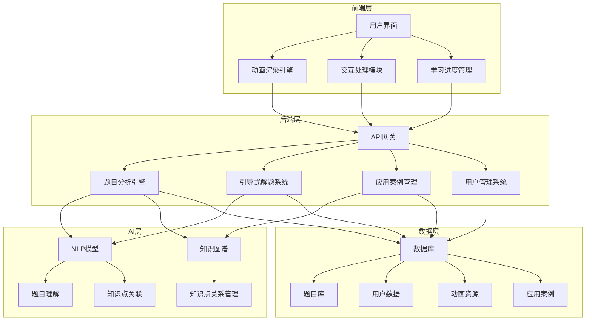

# 交互式科学教育辅助系统设计方案

## 1. 系统架构设计

### 1.1 整体架构

### 1.2 核心功能模块设计

#### 1.2.1 题目分析引擎
- **架构设计**：
  - 采用微服务架构，独立部署
  - 基于NLP技术和知识图谱实现
  - 支持RESTful API接口
- **技术实现**：
  - 使用Python + FastAPI构建
  - 集成预训练NLP模型（如BERT）
  - 构建学科知识图谱，使用Neo4j存储
  - 实现题目解析、知识点识别和难度评估算法

#### 1.2.2 引导式解题系统
- **架构设计**：
  - 基于规则引擎和机器学习模型
  - 支持个性化引导路径生成
  - 与题目分析引擎紧密集成
- **技术实现**：
  - 使用Python + Flask构建
  - 实现规则引擎，处理解题逻辑
  - 集成机器学习模型，预测学生解题能力
  - 实现交互式问答系统，基于对话管理技术

#### 1.2.3 交互式动画引擎
- **架构设计**：
  - 前端渲染为主，后端提供动画配置
  - 支持2D和3D动画
  - 模块化设计，便于扩展
- **技术实现**：
  - 前端：Three.js（3D）、Canvas API（2D）
  - 后端：提供动画参数配置和资源管理
  - 实现动画模板系统，支持不同类型的动画生成
  - 优化渲染性能，确保流畅体验

#### 1.2.4 实际应用关联系统
- **架构设计**：
  - 基于知识图谱的关联系统
  - 支持多维度的应用案例关联
  - 提供案例管理和检索功能
- **技术实现**：
  - 使用Neo4j存储知识点与应用案例的关联关系
  - 实现案例推荐算法，基于知识点相似性
  - 提供案例内容管理接口，支持教师和专家贡献内容

#### 1.2.5 学习进度追踪
- **架构设计**：
  - 分布式数据采集和分析
  - 实时进度更新和历史数据存储
  - 个性化学习报告生成
- **技术实现**：
  - 使用MongoDB存储学生学习数据
  - 实现数据采集SDK，记录学生操作行为
  - 集成数据分析工具，生成学习报告
  - 提供API接口，支持多设备同步

### 1.3 技术架构

| 层级 | 技术栈 | 组件 | 职责 |
|------|--------|------|------|
| 前端 | React/Vue + Three.js/Canvas API | 用户界面、动画渲染、交互处理 | 提供用户交互界面，渲染交互式动画 |
| 后端 | Python + FastAPI/Flask | API网关、业务逻辑处理 | 处理业务逻辑，提供API接口 |
| 数据层 | MongoDB/PostgreSQL + Neo4j | 数据存储、知识图谱 | 存储结构化数据和知识点关系 |
| AI层 | NLP模型 + 机器学习 | 题目分析、智能引导 | 实现智能题目分析和个性化引导 |
| 存储层 | 对象存储服务 | 动画资源、多媒体文件 | 存储大型静态资源 |
| 缓存层 | Redis | 热点数据缓存 | 提高系统响应速度 |

## 2. 核心功能实现方案

### 2.1 智能题目分析

#### 2.1.1 技术实现
- **NLP处理**：
  - 使用预训练BERT模型进行题目文本分析
  - 实现实体识别，提取题目中的关键信息
  - 构建题目分类模型，识别题目类型和知识点
- **知识图谱**：
  - 使用Neo4j构建学科知识图谱
  - 定义知识点之间的层级关系和关联关系
  - 实现基于图数据库的知识点检索和推理
- **难度评估**：
  - 基于题目复杂度、知识点难度和学生历史表现
  - 实现多维度难度评估算法
  - 支持动态调整题目难度

#### 2.1.2 流程设计
1. 接收题目文本输入
2. 使用NLP模型解析题目内容
3. 提取已知条件、求解目标和关键信息
4. 识别题目涉及的知识点
5. 评估题目难度
6. 生成题目分析报告

### 2.2 交互式动画系统

#### 2.2.1 技术实现
- **数学动画**：
  - 使用Canvas API实现2D几何图形变换
  - 使用Three.js实现3D几何模型
  - 实现函数图像动态绘制和参数调整
- **物理动画**：
  - 使用Three.js实现力学运动模拟
  - 实现电磁现象可视化
  - 开发光学实验模拟系统
- **化学动画**：
  - 使用Three.js实现分子结构动态展示
  - 开发化学反应过程动画
  - 实现交互式元素周期表

#### 2.2.2 交互设计
- **拖拽操作**：允许用户拖拽动画元素，实时观察变化
- **参数调整**：提供滑块、输入框等控件，调整动画参数
- **视角控制**：支持3D动画的视角旋转、缩放和平移
- **实时反馈**：对用户操作给予即时视觉反馈

### 2.3 引导式解题流程

#### 2.3.1 技术实现
- **规则引擎**：
  - 基于专家系统构建解题规则库
  - 实现规则匹配和推理机制
  - 支持规则的动态更新和扩展
- **机器学习**：
  - 基于学生历史数据，训练个性化引导模型
  - 预测学生解题能力和可能的错误
  - 生成个性化的解题引导路径
- **交互式问答**：
  - 基于对话管理技术，实现自然语言交互
  - 支持多轮对话，引导学生思考
  - 识别学生的错误思路，提供针对性纠正

#### 2.3.2 流程设计
1. 分析题目，确定知识点和解题步骤
2. 评估学生水平和解题能力
3. 生成个性化引导路径
4. 提供解题提示，引导学生思考
5. 接收学生输入，分析解题思路
6. 提供反馈和纠正，直到解题完成
7. 记录解题过程，更新学习数据

### 2.4 实际应用关联

#### 2.4.1 技术实现
- **案例管理**：
  - 构建案例数据库，存储应用案例信息
  - 实现案例的分类、标签和检索
  - 支持案例内容的多媒体展示
- **关联算法**：
  - 基于知识图谱，实现知识点与应用案例的关联
  - 开发案例推荐算法，根据知识点相似度推荐相关案例
  - 支持多维度的案例关联（工业、生活、科技等）
- **内容贡献**：
  - 提供教师和专家贡献案例的接口
  - 实现案例审核机制，确保质量
  - 支持案例的版本管理和更新

#### 2.4.2 流程设计
1. 分析题目涉及的知识点
2. 基于知识图谱检索相关应用案例
3. 根据学生兴趣和学习进度，推荐相关案例
4. 展示案例详情，包括应用场景、原理和影响
5. 提供案例相关的拓展阅读和资源

## 3. 数据库设计

### 3.1 数据模型

#### 3.1.1 用户数据模型
- **用户表**：
  - user_id (PK)
  - username
  - password_hash
  - role (student/teacher/admin)
  - email
  - created_at
  - updated_at

- **学生信息表**：
  - student_id (PK, FK to user_id)
  - grade
  - subject_preferences
  - learning_goals

- **教师信息表**：
  - teacher_id (PK, FK to user_id)
  - department
  - teaching_subjects
  - school

#### 3.1.2 题目数据模型
- **题目表**：
  - problem_id (PK)
  - content
  - subject (math/physics/chemistry)
  - difficulty_level
  - created_at
  - updated_at

- **知识点表**：
  - knowledge_id (PK)
  - name
  - description
  - subject
  - parent_id (FK to knowledge_id)

- **题目-知识点关联表**：
  - problem_id (FK)
  - knowledge_id (FK)
  - relevance_score

- **解题步骤表**：
  - step_id (PK)
  - problem_id (FK)
  - step_number
  - content
  - hint

#### 3.1.3 动画资源模型
- **动画表**：
  - animation_id (PK)
  - name
  - type (2d/3d)
  - subject
  - knowledge_id (FK)
  - resource_path
  - parameters
  - created_at

- **动画参数表**：
  - parameter_id (PK)
  - animation_id (FK)
  - name
  - type
  - default_value
  - min_value
  - max_value

#### 3.1.4 应用案例模型
- **案例表**：
  - case_id (PK)
  - title
  - description
  - category (industry/daily/technology)
  - content
  - media_url
  - created_at
  - updated_at

- **案例-知识点关联表**：
  - case_id (FK)
  - knowledge_id (FK)
  - relevance_score

#### 3.1.5 学习数据模型
- **解题记录表**：
  - record_id (PK)
  - user_id (FK)
  - problem_id (FK)
  - start_time
  - end_time
  - success (boolean)
  - steps_taken
  - hints_used

- **错误分析表**：
  - error_id (PK)
  - record_id (FK)
  - step_number
  - error_type
  - error_description
  - correction

- **知识点掌握表**：
  - mastery_id (PK)
  - user_id (FK)
  - knowledge_id (FK)
  - mastery_level (0-100)
  - last_practiced

### 3.2 数据库选择
- **关系型数据库**：PostgreSQL，用于存储结构化数据（用户、题目、解题步骤等）
- **图数据库**：Neo4j，用于存储知识图谱和知识点关联关系
- **文档数据库**：MongoDB，用于存储非结构化数据（学习记录、错误分析等）
- **对象存储**：MinIO/S3，用于存储动画资源和多媒体文件

## 4. 前端设计

### 4.1 技术栈
- **框架**：React/Vue
- **动画库**：Three.js、Canvas API
- **状态管理**：Redux/Vuex
- **路由**：React Router/Vue Router
- **UI组件库**：Ant Design/Element UI
- **样式**：CSS/Sass/Less
- **构建工具**：Webpack/Vite

### 4.2 页面设计

#### 4.2.1 首页
- **功能**：系统介绍、学科选择、热门题目推荐
- **布局**：顶部导航栏、学科卡片、推荐题目列表、应用案例展示
- **交互**：点击学科卡片进入对应学科页面，点击题目进入解题页面

#### 4.2.2 解题页面
- **功能**：题目展示、解题引导、交互式动画、应用案例关联
- **布局**：左侧题目区域、右侧动画区域、底部解题步骤和提示
- **交互**：拖拽动画元素、调整参数、点击获取提示、提交答案

#### 4.2.3 学习中心
- **功能**：学习进度查看、知识点掌握情况、个性化推荐
- **布局**：学习统计图表、知识点掌握雷达图、推荐题目列表
- **交互**：点击知识点查看详情，点击推荐题目进入解题

#### 4.2.4 教师控制台
- **功能**：题目管理、学生管理、学习数据分析
- **布局**：左侧导航栏、右侧内容区域、数据统计图表
- **交互**：上传题目、查看学生学习情况、生成学习报告

### 4.3 响应式设计
- **PC端**：完整功能，多列布局
- **平板端**：适配屏幕尺寸，调整布局
- **移动端**：简化界面，核心功能优先

## 5. 后端设计

### 5.1 技术栈
- **语言**：Python
- **框架**：FastAPI/Flask
- **数据库 ORM**：SQLAlchemy/MongoEngine
- **认证**：JWT
- **缓存**：Redis
- **消息队列**：RabbitMQ
- **部署**：Docker/Kubernetes

### 5.2 API设计

#### 5.2.1 用户管理API
- `POST /api/auth/register` - 用户注册
- `POST /api/auth/login` - 用户登录
- `GET /api/auth/profile` - 获取用户信息
- `PUT /api/auth/profile` - 更新用户信息

#### 5.2.2 题目管理API
- `GET /api/problems` - 获取题目列表
- `GET /api/problems/{id}` - 获取题目详情
- `POST /api/problems` - 创建题目（教师权限）
- `PUT /api/problems/{id}` - 更新题目（教师权限）
- `DELETE /api/problems/{id}` - 删除题目（教师权限）

#### 5.2.3 解题API
- `POST /api/solutions/analyze` - 分析题目
- `POST /api/solutions/guide` - 获取解题引导
- `POST /api/solutions/submit` - 提交答案
- `GET /api/solutions/history` - 获取解题历史

#### 5.2.4 动画API
- `GET /api/animations` - 获取动画列表
- `GET /api/animations/{id}` - 获取动画详情
- `POST /api/animations` - 创建动画（教师权限）
- `PUT /api/animations/{id}` - 更新动画（教师权限）

#### 5.2.5 应用案例API
- `GET /api/cases` - 获取应用案例列表
- `GET /api/cases/{id}` - 获取案例详情
- `POST /api/cases` - 创建案例（教师权限）
- `PUT /api/cases/{id}` - 更新案例（教师权限）

#### 5.2.6 学习数据API
- `GET /api/learning/progress` - 获取学习进度
- `GET /api/learning/knowledge` - 获取知识点掌握情况
- `GET /api/learning/report` - 获取学习报告

### 5.3 安全设计
- **认证与授权**：使用JWT进行身份验证，基于角色的权限控制
- **数据加密**：用户密码哈希存储，敏感数据加密传输
- **输入验证**：对所有API输入进行严格验证，防止注入攻击
- **速率限制**：防止API滥用和DoS攻击
- **日志记录**：记录系统操作和安全事件

## 6. 部署与集成方案

### 6.1 部署架构
- **前端**：部署在CDN上，静态资源缓存
- **后端**：容器化部署，使用Kubernetes编排
- **数据库**：主从架构，保证高可用
- **存储**：对象存储服务，支持海量数据存储
- **监控**：集成Prometheus和Grafana，监控系统运行状态

### 6.2 集成方案
- **与学校系统集成**：通过API接口与学校现有系统集成
- **与教育资源平台集成**：对接第三方教育资源平台，扩充内容
- **与AI模型集成**：集成最新的NLP和机器学习模型，提升智能水平

### 6.3 性能优化
- **前端优化**：代码分割、资源压缩、缓存策略
- **后端优化**：数据库索引、查询优化、缓存机制
- **动画优化**：使用WebGL加速、按需加载、降级策略
- **网络优化**：CDN加速、HTTP/2、WebSocket

## 7. 测试方案

### 7.1 测试策略
- **单元测试**：测试各个模块的功能
- **集成测试**：测试模块间的交互
- **端到端测试**：测试完整的用户流程
- **性能测试**：测试系统的响应时间和并发处理能力
- **安全测试**：测试系统的安全性和漏洞

### 7.2 测试工具
- **前端测试**：Jest、Cypress
- **后端测试**：pytest、Postman
- **性能测试**：JMeter、LoadRunner
- **安全测试**：OWASP ZAP、Burp Suite

### 7.3 测试环境
- **开发环境**：本地开发环境
- **测试环境**：与生产环境相似的测试环境
- **预生产环境**：模拟生产环境的预发布环境
- **生产环境**：正式运行环境

## 8. 维护与迭代

### 8.1 维护策略
- **监控系统**：实时监控系统运行状态，及时发现和解决问题
- **日志管理**：集中管理系统日志，便于故障排查
- **备份策略**：定期备份数据，确保数据安全
- **灾备方案**：建立灾难恢复机制，确保系统可靠性

### 8.2 迭代计划
- **功能迭代**：根据用户反馈和需求，持续添加新功能
- **性能优化**：不断优化系统性能，提升用户体验
- **内容更新**：定期更新题目库、动画资源和应用案例
- **技术升级**：跟进最新技术趋势，升级系统技术栈

## 9. 总结

本系统设计方案详细描述了交互式科学教育辅助系统的架构设计、技术实现方案和部署集成策略。系统采用现代化的技术栈，实现了智能题目分析、交互式动画、引导式解题和实际应用关联等核心功能，为学生提供了更加直观、有趣、有效的学习体验。

系统的设计充分考虑了可扩展性、性能优化和安全性，能够满足不同规模的应用需求。通过持续的维护和迭代，系统将不断提升功能和性能，为教育教学提供更好的支持。