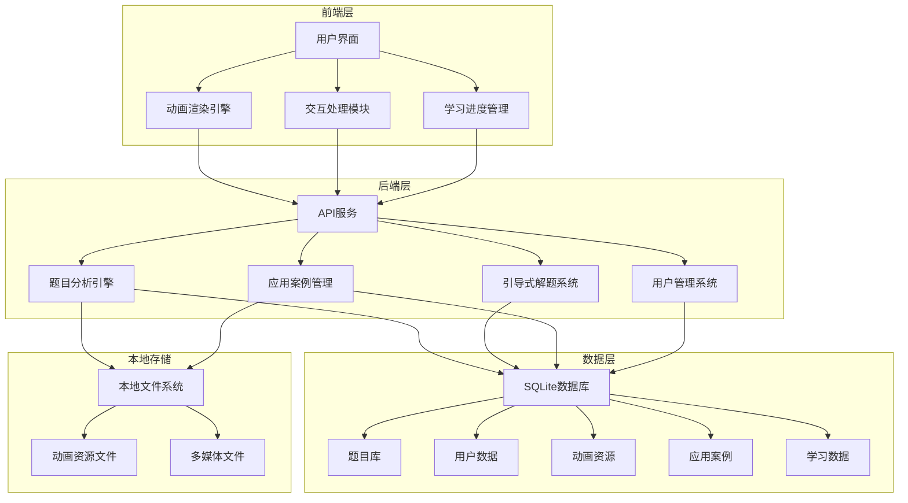

# 交互式科学教育辅助系统 - 轻量化数据库架构设计

## 1. 轻量化数据库选择

### 1.1 数据库对比分析

| 数据库类型 | 特点 | 优势 | 劣势 | 适用场景 |
|-----------|------|------|------|----------|
| SQLite | 嵌入式数据库，文件型 | 无需独立服务器，部署简单，轻量级，跨平台 | 并发性能有限，不适合高并发场景 | 本地开发、小型应用、原型验证 |
| H2 | 嵌入式数据库，支持内存模式 | 支持SQL标准，性能优异，跨平台 | 功能相对有限，社区较小 | 本地开发、测试环境、小型应用 |
| PostgreSQL | 关系型数据库 | 功能强大，支持复杂查询，社区活跃 | 需要独立部署，资源占用较大 | 生产环境、大型应用 |
| MongoDB | 文档型数据库 | 灵活的数据模型，适合非结构化数据 | 需要独立部署，资源占用较大 | 生产环境、大数据应用 |

### 1.2 推荐方案

**推荐使用 SQLite** 作为轻量化数据库方案，理由如下：
- **无需独立服务器**：SQLite是嵌入式数据库，以文件形式存储，无需安装和配置数据库服务器
- **跨平台**：SQLite支持Windows、Mac、Linux等多种操作系统
- **部署简单**：只需一个文件，复制即可部署
- **性能足够**：对于本地开发和小型应用，性能完全满足需求
- **兼容性好**：支持标准SQL语法，与其他关系型数据库兼容性高
- **社区活跃**：有丰富的文档和资源支持

## 2. 轻量化架构设计

### 2.1 整体架构



### 2.2 核心组件设计

#### 2.2.1 后端服务
- **技术栈**：Python + FastAPI（轻量级Web框架）
- **部署方式**：本地运行，无需容器化
- **依赖管理**：使用pip管理依赖，提供requirements.txt
- **启动方式**：提供start.bat（Windows）和start.sh（Mac）脚本

#### 2.2.2 数据库
- **数据库**：SQLite
- **连接方式**：直接文件连接，无需网络协议
- **数据库文件**：存储在项目目录下的data文件夹中
- **初始化**：提供数据库初始化脚本，自动创建表结构

#### 2.2.3 前端
- **技术栈**：React/Vue + Three.js/Canvas API
- **构建方式**：本地构建，生成静态文件
- **部署方式**：使用内置的静态文件服务器，或部署到本地Web服务器

#### 2.2.4 存储
- **动画资源**：存储在本地文件系统中，通过相对路径访问
- **多媒体文件**：存储在本地文件系统中，通过相对路径访问
- **缓存**：使用内存缓存，无需Redis等外部缓存服务

## 3. 数据库设计

### 3.1 表结构设计

#### 3.1.1 用户表（users）
| 字段名 | 数据类型 | 约束 | 描述 |
|--------|----------|------|------|
| user_id | INTEGER | PRIMARY KEY AUTOINCREMENT | 用户ID |
| username | TEXT | UNIQUE NOT NULL | 用户名 |
| password_hash | TEXT | NOT NULL | 密码哈希 |
| role | TEXT | NOT NULL | 角色（student/teacher/admin） |
| email | TEXT | UNIQUE | 邮箱 |
| created_at | TIMESTAMP | DEFAULT CURRENT_TIMESTAMP | 创建时间 |
| updated_at | TIMESTAMP | DEFAULT CURRENT_TIMESTAMP | 更新时间 |

#### 3.1.2 学生信息表（students）
| 字段名 | 数据类型 | 约束 | 描述 |
|--------|----------|------|------|
| student_id | INTEGER | PRIMARY KEY REFERENCES users(user_id) | 学生ID |
| grade | TEXT | | 年级 |
| subject_preferences | TEXT | | 学科偏好（JSON格式） |
| learning_goals | TEXT | | 学习目标（JSON格式） |

#### 3.1.3 教师信息表（teachers）
| 字段名 | 数据类型 | 约束 | 描述 |
|--------|----------|------|------|
| teacher_id | INTEGER | PRIMARY KEY REFERENCES users(user_id) | 教师ID |
| department | TEXT | | 部门 |
| teaching_subjects | TEXT | | 教学科目（JSON格式） |
| school | TEXT | | 学校 |

#### 3.1.4 题目表（problems）
| 字段名 | 数据类型 | 约束 | 描述 |
|--------|----------|------|------|
| problem_id | INTEGER | PRIMARY KEY AUTOINCREMENT | 题目ID |
| content | TEXT | NOT NULL | 题目内容 |
| subject | TEXT | NOT NULL | 学科（math/physics/chemistry） |
| difficulty_level | INTEGER | NOT NULL | 难度等级（1-5） |
| created_at | TIMESTAMP | DEFAULT CURRENT_TIMESTAMP | 创建时间 |
| updated_at | TIMESTAMP | DEFAULT CURRENT_TIMESTAMP | 更新时间 |

#### 3.1.5 知识点表（knowledge_points）
| 字段名 | 数据类型 | 约束 | 描述 |
|--------|----------|------|------|
| knowledge_id | INTEGER | PRIMARY KEY AUTOINCREMENT | 知识点ID |
| name | TEXT | NOT NULL | 知识点名称 |
| description | TEXT | | 知识点描述 |
| subject | TEXT | NOT NULL | 学科 |
| parent_id | INTEGER | REFERENCES knowledge_points(knowledge_id) | 父知识点ID |

#### 3.1.6 题目-知识点关联表（problem_knowledge）
| 字段名 | 数据类型 | 约束 | 描述 |
|--------|----------|------|------|
| problem_id | INTEGER | REFERENCES problems(problem_id) | 题目ID |
| knowledge_id | INTEGER | REFERENCES knowledge_points(knowledge_id) | 知识点ID |
| relevance_score | REAL | DEFAULT 1.0 | 关联度分数 |
| PRIMARY KEY | | (problem_id, knowledge_id) | 复合主键 |

#### 3.1.7 解题步骤表（solution_steps）
| 字段名 | 数据类型 | 约束 | 描述 |
|--------|----------|------|------|
| step_id | INTEGER | PRIMARY KEY AUTOINCREMENT | 步骤ID |
| problem_id | INTEGER | REFERENCES problems(problem_id) | 题目ID |
| step_number | INTEGER | NOT NULL | 步骤序号 |
| content | TEXT | NOT NULL | 步骤内容 |
| hint | TEXT | | 提示信息 |

#### 3.1.8 动画表（animations）
| 字段名 | 数据类型 | 约束 | 描述 |
|--------|----------|------|------|
| animation_id | INTEGER | PRIMARY KEY AUTOINCREMENT | 动画ID |
| name | TEXT | NOT NULL | 动画名称 |
| type | TEXT | NOT NULL | 动画类型（2d/3d） |
| subject | TEXT | NOT NULL | 学科 |
| knowledge_id | INTEGER | REFERENCES knowledge_points(knowledge_id) | 知识点ID |
| resource_path | TEXT | NOT NULL | 资源路径 |
| parameters | TEXT | | 参数配置（JSON格式） |
| created_at | TIMESTAMP | DEFAULT CURRENT_TIMESTAMP | 创建时间 |

#### 3.1.9 应用案例表（cases）
| 字段名 | 数据类型 | 约束 | 描述 |
|--------|----------|------|------|
| case_id | INTEGER | PRIMARY KEY AUTOINCREMENT | 案例ID |
| title | TEXT | NOT NULL | 案例标题 |
| description | TEXT | | 案例描述 |
| category | TEXT | NOT NULL | 类别（industry/daily/technology） |
| content | TEXT | NOT NULL | 案例内容 |
| media_url | TEXT | | 媒体文件路径 |
| created_at | TIMESTAMP | DEFAULT CURRENT_TIMESTAMP | 创建时间 |
| updated_at | TIMESTAMP | DEFAULT CURRENT_TIMESTAMP | 更新时间 |

#### 3.1.10 案例-知识点关联表（case_knowledge）
| 字段名 | 数据类型 | 约束 | 描述 |
|--------|----------|------|------|
| case_id | INTEGER | REFERENCES cases(case_id) | 案例ID |
| knowledge_id | INTEGER | REFERENCES knowledge_points(knowledge_id) | 知识点ID |
| relevance_score | REAL | DEFAULT 1.0 | 关联度分数 |
| PRIMARY KEY | | (case_id, knowledge_id) | 复合主键 |

#### 3.1.11 解题记录表（solution_records）
| 字段名 | 数据类型 | 约束 | 描述 |
|--------|----------|------|------|
| record_id | INTEGER | PRIMARY KEY AUTOINCREMENT | 记录ID |
| user_id | INTEGER | REFERENCES users(user_id) | 用户ID |
| problem_id | INTEGER | REFERENCES problems(problem_id) | 题目ID |
| start_time | TIMESTAMP | DEFAULT CURRENT_TIMESTAMP | 开始时间 |
| end_time | TIMESTAMP | | 结束时间 |
| success | BOOLEAN | | 是否成功 |
| steps_taken | INTEGER | | 采取的步骤数 |
| hints_used | INTEGER | | 使用的提示数 |

#### 3.1.12 错误分析表（error_analysis）
| 字段名 | 数据类型 | 约束 | 描述 |
|--------|----------|------|------|
| error_id | INTEGER | PRIMARY KEY AUTOINCREMENT | 错误ID |
| record_id | INTEGER | REFERENCES solution_records(record_id) | 记录ID |
| step_number | INTEGER | | 步骤序号 |
| error_type | TEXT | | 错误类型 |
| error_description | TEXT | | 错误描述 |
| correction | TEXT | | 纠正建议 |

#### 3.1.13 知识点掌握表（knowledge_mastery）
| 字段名 | 数据类型 | 约束 | 描述 |
|--------|----------|------|------|
| mastery_id | INTEGER | PRIMARY KEY AUTOINCREMENT | 掌握ID |
| user_id | INTEGER | REFERENCES users(user_id) | 用户ID |
| knowledge_id | INTEGER | REFERENCES knowledge_points(knowledge_id) | 知识点ID |
| mastery_level | INTEGER | DEFAULT 0 | 掌握程度（0-100） |
| last_practiced | TIMESTAMP | DEFAULT CURRENT_TIMESTAMP | 最后练习时间 |

### 3.2 索引设计

为了提高查询性能，在以下字段上创建索引：

- `users(username)`：加速用户登录和查询
- `problems(subject, difficulty_level)`：加速题目筛选
- `knowledge_points(subject)`：加速知识点查询
- `solution_records(user_id, problem_id)`：加速用户解题记录查询
- `knowledge_mastery(user_id, knowledge_id)`：加速知识点掌握情况查询

## 4. 本地部署方案

### 4.1 环境要求

- **操作系统**：Windows 10+ 或 macOS 10.14+
- **Python**：3.8+
- **Node.js**：14+（前端构建）
- **浏览器**：Chrome、Firefox、Safari、Edge 最新版本

### 4.2 部署步骤

#### 4.2.1 Windows部署

1. **安装依赖**：
   - 安装Python 3.8+（从官网下载并安装）
   - 安装Node.js 14+（从官网下载并安装）

2. **克隆项目**：
   ```bash
   git clone <项目地址>
   cd inter-act-system
   ```

3. **安装Python依赖**：
   ```bash
   pip install -r requirements.txt
   ```

4. **安装前端依赖**：
   ```bash
   cd frontend
   npm install
   npm run build
   cd ..
   ```

5. **初始化数据库**：
   ```bash
   python init_db.py
   ```

6. **启动服务**：
   ```bash
   start.bat
   ```

7. **访问系统**：
   打开浏览器，访问 `http://localhost:8000`

#### 4.2.2 Mac部署

1. **安装依赖**：
   - 安装Python 3.8+（使用Homebrew或从官网下载）
   - 安装Node.js 14+（使用Homebrew或从官网下载）

2. **克隆项目**：
   ```bash
   git clone <项目地址>
   cd inter-act-system
   ```

3. **安装Python依赖**：
   ```bash
   pip3 install -r requirements.txt
   ```

4. **安装前端依赖**：
   ```bash
   cd frontend
   npm install
   npm run build
   cd ..
   ```

5. **初始化数据库**：
   ```bash
   python3 init_db.py
   ```

6. **启动服务**：
   ```bash
   chmod +x start.sh
   ./start.sh
   ```

7. **访问系统**：
   打开浏览器，访问 `http://localhost:8000`

### 4.3 配置文件

**config.py**：
```python
# 数据库配置
DATABASE_PATH = "data/db.sqlite3"

# 服务器配置
HOST = "0.0.0.0"
PORT = 8000

# 静态文件配置
STATIC_DIR = "frontend/build"

# 动画资源配置
ANIMATION_DIR = "data/animations"

# 媒体文件配置
MEDIA_DIR = "data/media"
```

### 4.4 启动脚本

**start.bat**（Windows）：
```batch
@echo off
set PYTHONUNBUFFERED=1
python app.py
pause
```

**start.sh**（Mac）：
```bash
#!/bin/bash
PYTHONUNBUFFERED=1 python3 app.py
```

**app.py**：
```python
from fastapi import FastAPI
from fastapi.staticfiles import StaticFiles
import uvicorn
import config

app = FastAPI()

# 挂载静态文件
app.mount("/", StaticFiles(directory=config.STATIC_DIR, html=True), name="static")

# API路由
# ... 省略API路由定义 ...

if __name__ == "__main__":
    uvicorn.run("app:app", host=config.HOST, port=config.PORT, reload=True)
```

## 5. 数据迁移策略

### 5.1 从原有数据库迁移

如果需要从原有数据库（如PostgreSQL、MongoDB）迁移数据到SQLite，可以使用以下步骤：

1. **导出数据**：从原有数据库导出数据为CSV或JSON格式
2. **转换数据**：将数据转换为SQLite兼容的格式
3. **导入数据**：使用SQLite的导入功能将数据导入到新数据库

### 5.2 数据备份与恢复

**备份**：
- 直接复制SQLite数据库文件（data/db.sqlite3）即可完成备份

**恢复**：
- 将备份的数据库文件复制回data目录，覆盖原有文件

## 6. 性能优化

### 6.1 数据库优化

- **使用索引**：在频繁查询的字段上创建索引
- **批量操作**：使用批量插入和更新，减少数据库操作次数
- **连接池**：使用连接池管理数据库连接，减少连接开销
- **查询优化**：优化SQL查询语句，避免全表扫描

### 6.2 应用优化

- **缓存**：使用内存缓存存储热点数据
- **异步处理**：使用异步IO处理并发请求
- **懒加载**：按需加载数据，减少初始加载时间
- **压缩**：压缩静态文件和响应数据

### 6.3 动画优化

- **按需加载**：只加载当前需要的动画资源
- **缓存**：缓存已加载的动画资源
- **降级策略**：在低性能设备上使用简化版动画

## 7. 安全性考虑

### 7.1 数据安全

- **密码加密**：使用bcrypt等算法加密存储用户密码
- **SQL注入防护**：使用参数化查询，避免SQL注入攻击
- **XSS防护**：对用户输入进行过滤和转义
- **CORS配置**：正确配置CORS策略，避免跨域攻击

### 7.2 本地安全

- **文件权限**：设置适当的文件权限，保护数据库文件和资源文件
- **防病毒**：确保本地环境安全，定期进行病毒扫描
- **备份**：定期备份数据库文件，防止数据丢失

## 8. 扩展性考虑

### 8.1 功能扩展

- **模块化设计**：采用模块化架构，便于添加新功能
- **插件机制**：支持插件扩展，增强系统功能
- **API设计**：提供标准API接口，支持与其他系统集成

### 8.2 数据扩展

- **分表策略**：当数据量增大时，可以考虑分表存储
- **归档策略**：对历史数据进行归档，保持数据库性能
- **外部存储**：对于大型媒体文件，可以考虑使用外部存储服务

### 8.3 部署扩展

- **容器化**：支持Docker容器化部署，便于在不同环境中快速部署
- **云部署**：支持部署到云服务，实现更高级的功能（如多用户、高并发）

## 9. 总结

本轻量化数据库架构设计方案采用SQLite作为核心数据库，结合本地文件系统存储静态资源，实现了一个轻量级、易部署的交互式科学教育辅助系统。该方案具有以下优势：

- **部署简单**：无需安装和配置独立的数据库服务器，只需复制文件即可部署
- **跨平台**：支持Windows和Mac等多种操作系统
- **性能足够**：对于本地开发和小型应用，性能完全满足需求
- **数据安全**：采用SQLite的事务支持和加密功能，确保数据安全
- **扩展性强**：模块化设计和标准API接口，便于功能扩展和系统集成

通过本方案，用户可以在本地快速部署和运行交互式科学教育辅助系统，无需复杂的环境配置，即可体验系统的核心功能。同时，该方案也为后续的功能扩展和云部署提供了基础架构。