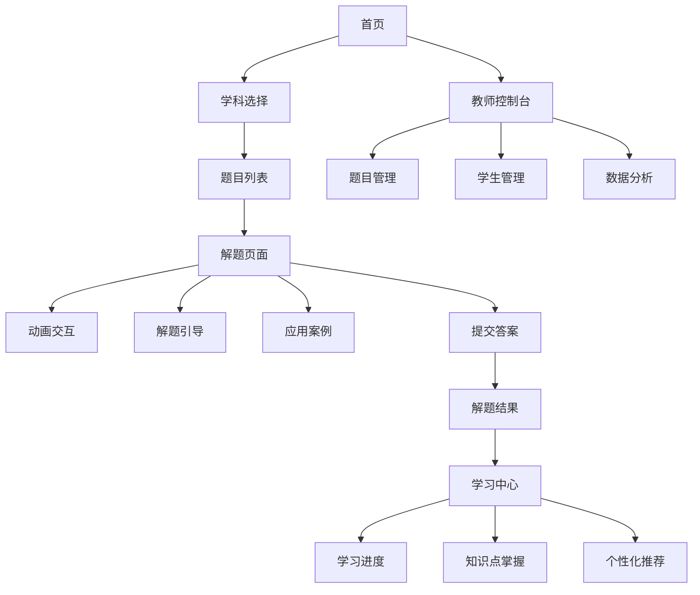

# 交互式科学教育辅助系统页面交互设计方案

## 1. 设计目标

### 1.1 用户体验目标
- **直观性**：界面设计简洁明了，操作流程清晰
- **交互性**：提供丰富的交互元素，增强用户参与感
- **响应性**：系统响应及时，反馈明确
- **个性化**：根据用户需求和学习进度，提供定制化界面
- **一致性**：保持界面风格和交互模式的一致性

### 1.2 设计原则
- **以学生为中心**：设计符合学生认知特点和学习习惯
- **可视化优先**：通过动画和图表，直观展示抽象概念
- **渐进式引导**：提供分层次的解题引导，适应不同水平的学生
- **情境化学习**：将知识点与实际应用场景关联，增强学习动力
- **多设备适配**：支持PC、平板和移动设备，提供一致的用户体验

## 2. 页面结构设计

### 2.1 整体布局
- **顶部导航栏**：系统 logo、学科选择、用户中心、通知
- **左侧菜单栏**：功能导航，包括首页、解题中心、学习中心、应用案例等
- **主内容区**：根据当前功能展示相应内容
- **右侧辅助区**：显示相关信息、推荐内容或工具
- **底部状态栏**：版权信息、系统状态、快速链接

### 2.2 页面流程

## 3. 核心页面设计

### 3.1 首页

#### 3.1.1 页面布局
- **顶部**：系统 logo、导航菜单、用户登录/注册
- **中部**：学科选择卡片（数学、物理、化学）、热门题目推荐、应用案例展示
- **底部**：系统介绍、功能亮点、使用指南

#### 3.1.2 交互设计
- **学科选择**：点击学科卡片进入对应学科的题目列表页面
- **热门题目**：点击题目卡片进入解题页面
- **应用案例**：点击案例卡片查看详细信息
- **搜索功能**：支持按关键词搜索题目和案例
- **个性化推荐**：根据用户历史数据推荐相关内容

#### 3.1.3 视觉设计
- **配色方案**：主色调为蓝色（#1890ff），辅以橙色（#fa8c16）和绿色（#52c41a）
- **卡片设计**：圆角卡片，带有轻微阴影，悬停时有放大效果
- **图标设计**：使用简洁的线性图标，配合主题色
- **字体**：主标题使用18-24px，副标题16px，正文14px

### 3.2 解题页面

#### 3.2.1 页面布局
- **左侧**：题目描述、已知条件、求解目标
- **右侧**：交互式动画区域，支持参数调整和操作
- **底部**：解题步骤、提示按钮、答案输入框、提交按钮
- **顶部**：题目难度、知识点标签、应用案例链接

#### 3.2.2 交互设计
- **动画交互**：
  - 支持拖拽元素（如几何图形、物理对象）
  - 提供滑块调整参数（如角度、速度、浓度等）
  - 支持3D视角控制（旋转、缩放、平移）
  - 实时更新动画效果，响应参数变化
- **解题引导**：
  - 点击提示按钮，显示不同层次的解题提示
  - 支持步骤导航，可跳转到任意解题步骤
  - 输入答案后，系统即时反馈正确性
  - 错误时提供针对性的纠正和解释
- **应用案例**：
  - 点击知识点标签，显示相关应用案例
  - 提供案例详情弹窗，包含图文和视频

#### 3.2.3 视觉设计
- **动画区域**：占据页面右侧60%的空间，背景为浅灰色（#f5f5f5）
- **题目区域**：左侧40%的空间，白色背景，清晰的文本布局
- **步骤指示器**：底部显示解题步骤进度，当前步骤高亮
- **按钮设计**：主要按钮使用主题色，次要按钮使用灰色
- **反馈效果**：正确答案显示绿色对勾，错误答案显示红色叉号

### 3.3 学习中心

#### 3.3.1 页面布局
- **顶部**：学习统计概览（总解题数、正确率、学习时长）
- **中部**：知识点掌握雷达图、学习进度条
- **底部**：最近解题记录、推荐题目列表
- **右侧**：学习建议、成就徽章

#### 3.3.2 交互设计
- **数据可视化**：
  - 雷达图展示各知识点的掌握程度
  - 进度条显示学习目标的完成情况
  - 图表支持交互，点击可查看详细数据
- **学习记录**：
  - 显示最近解题的题目、时间、结果
  - 点击记录可重新查看题目和解题过程
- **个性化推荐**：
  - 根据知识点掌握情况，推荐需要加强的题目
  - 基于学习历史，推荐相关应用案例

#### 3.3.3 视觉设计
- **图表设计**：使用主题色的渐变效果，清晰易读
- **进度条**：使用绿色到红色的渐变，直观显示掌握程度
- **卡片设计**：推荐题目使用白色卡片，带有轻微阴影
- **徽章设计**：成就徽章使用金色和银色，突出荣誉感

### 3.4 教师控制台

#### 3.4.1 页面布局
- **左侧**：功能导航（题目管理、学生管理、数据分析）
- **右侧**：内容区域，根据选择的功能显示相应内容
- **顶部**：搜索功能、筛选条件、批量操作

#### 3.4.2 交互设计
- **题目管理**：
  - 支持题目上传、编辑、删除
  - 批量导入题目功能
  - 题目预览和测试功能
- **学生管理**：
  - 查看学生列表和学习情况
  - 导出学生学习报告
  - 发送学习建议和通知
- **数据分析**：
  - 班级整体学习情况统计
  - 知识点掌握情况分析
  - 解题时间和正确率分析

#### 3.4.3 视觉设计
- **表格设计**：清晰的表格布局，支持排序和筛选
- **按钮设计**：操作按钮使用图标+文字组合，清晰易懂
- **图表设计**：使用柱状图、折线图等展示数据，便于分析
- **颜色方案**：专业的蓝色调，体现教师角色的专业性

## 4. 动画交互设计

### 4.1 数学动画

#### 4.1.1 几何图形变换
- **功能**：展示几何图形的平移、旋转、缩放等变换
- **交互**：
  - 拖拽图形顶点，实时更新图形
  - 调整变换参数（角度、比例等）
  - 播放变换动画，展示过程
- **应用场景**：平面几何、立体几何教学

#### 4.1.2 函数图像动态绘制
- **功能**：绘制和展示各种函数图像
- **交互**：
  - 输入函数表达式，实时生成图像
  - 调整参数（如系数、定义域等）
  - 支持多函数图像叠加比较
- **应用场景**：代数、微积分教学

#### 4.1.3 概率分布可视化
- **功能**：展示各种概率分布的图像
- **交互**：
  - 调整分布参数（如均值、方差等）
  - 实时计算概率值
  - 支持多种分布类型切换
- **应用场景**：概率统计教学

### 4.2 物理动画

#### 4.2.1 力学运动模拟
- **功能**：模拟物体的运动状态和受力情况
- **交互**：
  - 调整初始条件（位置、速度、力等）
  - 观察运动轨迹和能量变化
  - 支持暂停、继续、重置操作
- **应用场景**：牛顿运动定律、能量守恒教学

#### 4.2.2 电磁现象可视化
- **功能**：展示电场、磁场的分布和相互作用
- **交互**：
  - 调整电荷、电流等参数
  - 观察场线分布和力的作用
  - 支持3D视角查看
- **应用场景**：电磁学教学

#### 4.2.3 光学实验模拟
- **功能**：模拟光的反射、折射、衍射等现象
- **交互**：
  - 调整光源参数（波长、强度等）
  - 改变介质类型和界面
  - 观察光路变化
- **应用场景**：光学教学

### 4.3 化学动画

#### 4.3.1 分子结构动态展示
- **功能**：展示分子的三维结构和化学键
- **交互**：
  - 旋转、缩放分子模型
  - 显示分子轨道和电子云
  - 支持不同分子结构的切换
- **应用场景**：有机化学、无机化学教学

#### 4.3.2 化学反应过程动画
- **功能**：展示化学反应的微观过程
- **交互**：
  - 调整反应条件（温度、浓度等）
  - 观察分子的碰撞和化学键的断裂/形成
  - 显示反应能量变化
- **应用场景**：化学反应原理教学

#### 4.3.3 元素周期表交互
- **功能**：交互式元素周期表
- **交互**：
  - 点击元素查看详细信息
  - 按族、周期、金属性等筛选元素
  - 显示元素的物理和化学性质
- **应用场景**：元素化学教学

## 5. 响应式设计

### 5.1 设备适配
- **PC端**（1200px以上）：完整功能，多列布局
- **平板端**（768px-1199px）：调整布局，保持核心功能
- **移动端**（767px以下）：简化界面，优先显示核心内容

### 5.2 适配策略
- **布局调整**：使用弹性布局和网格系统，根据屏幕尺寸自动调整
- **内容优先级**：在小屏幕上优先显示核心内容，次要内容可折叠或隐藏
- **交互优化**：针对触摸设备优化交互元素大小和间距
- **性能优化**：在移动设备上降低动画复杂度，提高加载速度

### 5.3 测试方案
- 使用浏览器开发者工具模拟不同设备尺寸
- 在实际设备上测试页面布局和交互
- 确保在各种设备上的用户体验一致

## 6. UI设计规范

### 6.1 色彩系统
- **主色调**：蓝色（#1890ff）- 代表科技、智慧
- **辅助色**：
  - 橙色（#fa8c16）- 代表活力、创新
  - 绿色（#52c41a）- 代表成功、进步
  - 红色（#f5222d）- 代表错误、警告
- **中性色**：
  - 白色（#ffffff）- 背景
  - 浅灰色（#f5f5f5）- 次要背景
  - 中灰色（#8c8c8c）- 次要文字
  - 深灰色（#262626）- 主要文字

### 6.2 字体系统
- **主字体**：系统默认字体，确保跨平台一致性
- **字号**：
  - 主标题：24px
  - 副标题：18px
  - 正文：14px
  - 小文字：12px
- **字重**：
  - 标题：600
  - 正文：400
  - 强调：500

### 6.3 组件设计
- **按钮**：
  - 主要按钮：填充主题色，白色文字
  - 次要按钮：白色背景，主题色边框和文字
  - 禁用按钮：灰色背景，白色文字
- **输入框**：
  - 正常状态：浅灰色边框
  - 聚焦状态：主题色边框
  - 错误状态：红色边框
- **卡片**：
  - 圆角：8px
  - 阴影：0 2px 8px rgba(0, 0, 0, 0.15)
  - 悬停效果：轻微放大和阴影加深
- **图标**：
  - 线性图标，风格统一
  - 尺寸：16px、24px、32px
  - 颜色：与文字颜色一致

### 6.4 动画效果
- **过渡动画**：页面切换使用淡入淡出效果
- **交互反馈**：按钮点击有轻微的缩放效果
- **加载动画**：使用骨架屏或旋转加载动画
- **数据更新**：使用平滑的过渡效果

## 7. 原型设计

### 7.1 首页原型
- **布局**：响应式网格布局，学科卡片并排显示
- **交互**：卡片悬停效果，点击进入对应页面
- **内容**：系统介绍、学科选择、热门题目、应用案例

### 7.2 解题页面原型
- **布局**：左右分栏布局，左侧题目，右侧动画
- **交互**：动画区域支持拖拽和参数调整，底部提供解题步骤和提示
- **内容**：题目描述、交互式动画、解题引导、应用案例

### 7.3 学习中心原型
- **布局**：顶部统计概览，中部数据可视化，底部学习记录
- **交互**：图表支持点击查看详情，推荐题目可直接点击进入
- **内容**：学习统计、知识点掌握情况、最近解题记录、个性化推荐

### 7.4 教师控制台原型
- **布局**：左侧导航栏，右侧内容区域
- **交互**：表格支持排序和筛选，批量操作功能
- **内容**：题目管理、学生管理、数据分析

## 8. 总结

本页面交互设计方案详细描述了交互式科学教育辅助系统的页面布局、交互设计和视觉风格，旨在为学生提供直观、有趣、有效的学习体验。通过精心设计的界面和交互元素，系统能够更好地支持学生的学习过程，帮助学生理解抽象概念，建立知识与实践的联系，激发学习兴趣。

设计方案充分考虑了不同设备的适配需求，确保在PC、平板和移动设备上都能提供良好的用户体验。同时，通过标准化的UI设计规范，保证了系统界面的一致性和专业性。

后续将基于此设计方案，进一步开发和实现系统的前端界面，为用户提供优质的学习工具。